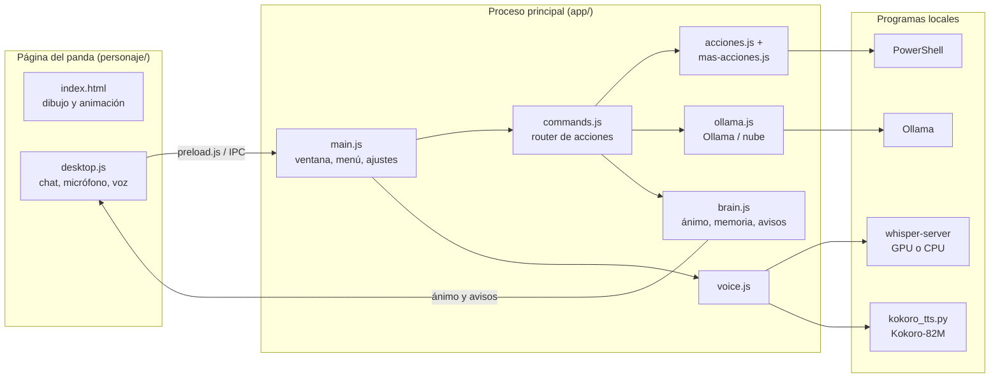
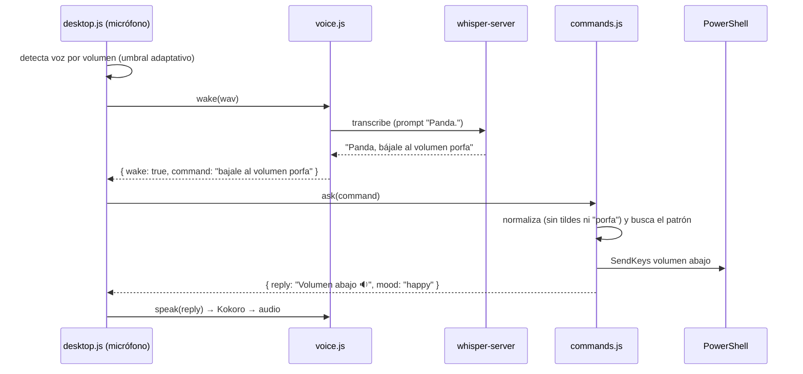

# Arquitectura de MicroPanda

Guía para entender cómo funciona por dentro y dónde tocar cada cosa.

## Vista general

- **Página** (`personaje/`): HTML + SVG sin frameworks. No tiene acceso a Node; habla con la app solo por
  `window.micropanda` (definido en `app/preload.js`).
- **Proceso principal** (`app/`): Electron + Node. Ejecuta acciones, maneja la voz y guarda la memoria.

## Qué pasa cuando dices "Panda, bájale al volumen"

Si ningún patrón coincide, `commands.js` pregunta a **Ollama** (`ollama.js → interpret`), que solo puede
**elegir** una acción de la misma lista (o responder una charla). Nunca ejecuta texto libre.

## Módulos

| Archivo | Responsabilidad |
|---|---|
| `app/main.js` | Ventana transparente, menú y bandeja, atajos, ventana de Ajustes, captura de pantalla, pasear, actualizaciones, IPC |
| `app/preload.js` | Puente seguro (`contextBridge`) entre las páginas y la app |
| `app/commands.js` | Router: normaliza la frase, busca la acción, confirma, encadena ("y luego"), registro, plugins, Ollama |
| `app/acciones.js` | Acciones de PC, internet, tareas, notas, rutinas, personalidad… |
| `app/mas-acciones.js` | Pantalla (OCR), documentos (búsqueda BM25), agenda, noticias, Wikipedia, pasear |
| `app/tiempo.js` | Entiende el tiempo en español latino y lo dice en voz natural |
| `app/brain.js` | Memoria (`~/.micropanda/memoria.json`), ánimo automático, recordatorios, tareas, pomodoro, avisos |
| `app/ollama.js` | Ollama (local) y modelo en la nube opcional; historial de conversación |
| `app/voice.js` | whisper-server (GPU con CUDA o CPU), palabra de activación, Kokoro y Piper |
| `app/kokoro_tts.py` | Servidor de voz Kokoro-82M (pronunciación `es-419`) |
| `app/ocr.ps1` | OCR de Windows (`Windows.Media.Ocr`) |
| `personaje/index.html` | Dibujo (PNG en capas + ojos/boca en SVG), resortes, ánimos, gestos, gorritos |
| `personaje/desktop.js` | Globo de chat, micrófono, palabra de activación, hablar frase por frase, boca por sílabas |
| `personaje/ajustes.html` | Ventana de Ajustes |

## El dibujo del panda

El personaje son dos imágenes de 1000×1000 con fondo transparente — `body.png` (cuerpo y laptop) y
`head.png` (capucha y cara **sin ojos**) — más ojos, párpados, boca, rubor y efectos dibujados en SVG.
`rig.json` / `rig.js` dicen dónde va cada cosa:

| Clave | Qué es |
|---|---|
| `eyes` | Centro y tamaño de cada ojo (`cx`, `cy`, `rx`, `ry`) y su brillo (`hx`, `hy`…) |
| `rim` | Borde de la capucha: parábola `y = y0 + k·(x − cx)²`; los ojos se recortan debajo |
| `pivot` | Punto donde gira la cabeza |

Para cambiar el dibujo: reemplaza `head.png`, `body.png` y `panda.png` y ajusta `rig.json` (y `rig.js`, que es
lo mismo como script). La animación funciona igual.

## Memoria y ajustes

`brain.js` guarda todo en `%USERPROFILE%\.micropanda\memoria.json` (se puede cambiar con `MICROPANDA_HOME`).
Los ajustes nuevos se agregan en `DEFAULTS.settings` y, si se editan desde la ventana de Ajustes, en
`EDITABLE` de `main.js`.

## Variables de entorno útiles

| Variable | Para qué |
|---|---|
| `MICROPANDA_HOME` | Otra carpeta para la memoria (las pruebas usan una temporal) |
| `MICROPANDA_VOICE_DIR` | Otra carpeta para la voz |
| `MICROPANDA_MODEL` | Forzar un modelo de Ollama |
| `MICROPANDA_VOICE` | Voz de Kokoro por defecto |
| `OLLAMA_HOST` | Ollama en otra dirección |
